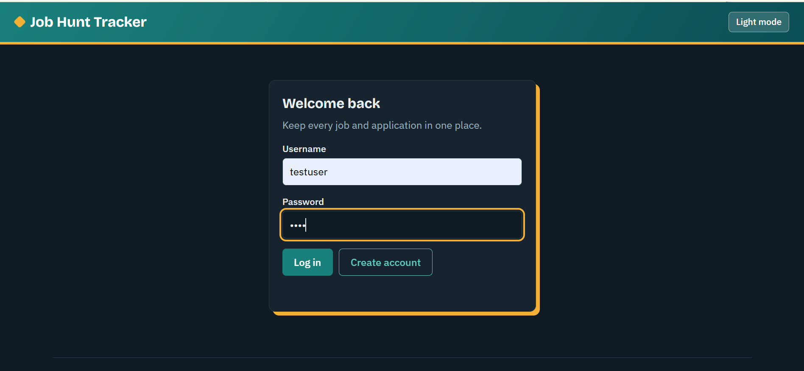
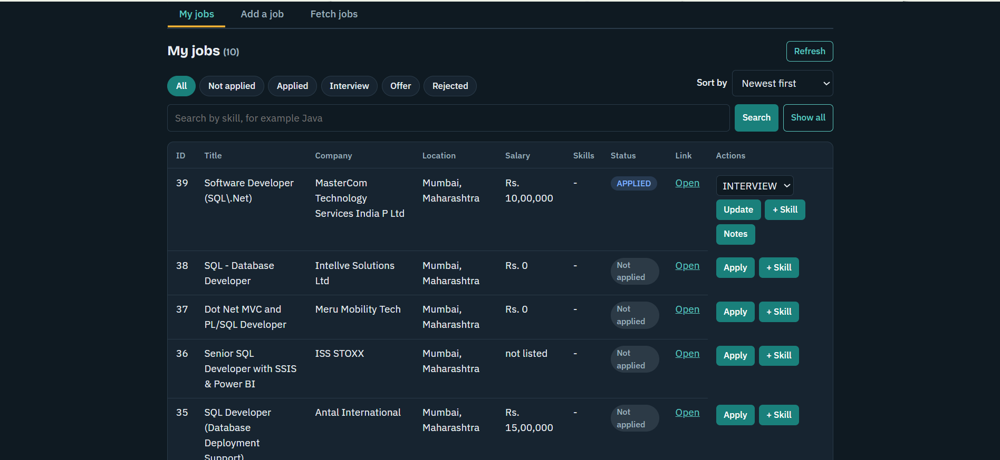
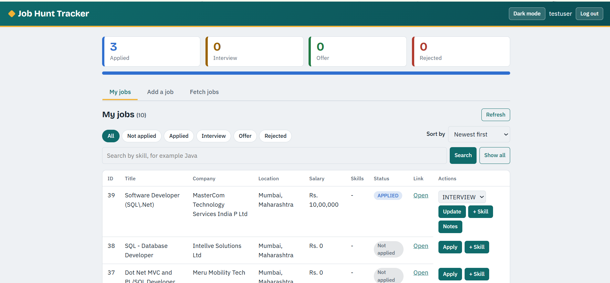

# Job Hunt Tracker

A Java full-stack web app to keep track of job applications. You can add jobs by hand or fetch them from the Adzuna job API, apply, move each application through its stages, add skills and notes, and see a summary. Each user sees only their own jobs.

## Screenshots





## Features

- Register and log in. Two roles: USER and ADMIN.
- Add full-time jobs and internships, or fetch jobs from Adzuna.
- Apply to a job and change its status. Allowed order: Applied, then Interview or Rejected, then Offer or Rejected. Offer and Rejected are final.
- Add skills to a job and search by skill.
- Add one note per application per day.
- Status summary, filter by status, and sort.
- Admin only: delete a job, and start or stop a background watcher that fetches new jobs every few minutes.
- Light and dark mode. The table turns into cards on a phone.

## Tech stack

- Java 21, Spring Boot 4.1
- Spring Web MVC (REST API), Spring Data JPA, Hibernate, Spring Security
- MySQL
- Maven
- Adzuna API, with `java.net.http.HttpClient` and Gson
- Plain HTML, CSS and JavaScript for the frontend (no framework)

## How to run

You need Java 21 or newer, Maven, and MySQL.

1. Create the database in MySQL (for example in MySQL Workbench):
   ```sql
   CREATE DATABASE jobtracker_h;
   ```
2. Get a free app id and app key from the Adzuna developer site.
3. Copy `config.properties.example` to `config.properties` (next to `pom.xml`) and fill in your own values. This file is in `.gitignore`, so it is never uploaded.
4. Open a terminal in the project folder and run:
   ```
   mvn -q clean spring-boot:run
   ```
5. Open http://localhost:8081/

The first run downloads the libraries and takes a few minutes. Hibernate creates the tables by itself. The admin account is created once at startup from `admin.username` and `admin.password`. Other users register on the login page.

## API

Everything except `/hello`, `/api/auth/register` and the page files needs a login (HTTP Basic).

| Method | URL | Who |
|---|---|---|
| POST | `/api/auth/register` | everyone |
| GET | `/api/auth/me` | logged in |
| GET | `/api/jobs` (optional `?skill=`) | logged in |
| GET | `/api/jobs/{id}` | logged in |
| POST | `/api/jobs` | logged in |
| DELETE | `/api/jobs/{id}` | ADMIN |
| POST | `/api/jobs/{id}/skills` | logged in |
| POST | `/api/jobs/{id}/apply` | logged in |
| PUT | `/api/jobs/{id}/status` | logged in |
| GET, POST | `/api/jobs/{id}/notes` | logged in |
| GET | `/api/applications` | logged in |
| GET | `/api/applications/summary` | logged in |
| POST | `/api/adzuna/fetch?what=&where=` | logged in |
| POST | `/api/watcher/start?what=&where=&minutes=` | ADMIN |
| POST | `/api/watcher/stop` | ADMIN |
| GET | `/api/watcher/status` | logged in |

Errors come back as JSON like `{"message": "..."}` with a suitable status code (400, 401, 403, 404, 409, 502 or 500).

## Project structure

Package `com.aditya.jobtracker`:

- `model` - JPA entities (Job with FullTimeJob and InternshipJob, Company, Skill, Application, ApplicationNote, AppUser)
- `repository` - Spring Data repositories
- `service` - business logic and transactions
- `controller` - REST controllers and the global exception handler
- `dto` - request and response records (entities are never sent as JSON)
- `client` - the Adzuna API client
- `watcher` - the background thread that fetches jobs
- `security` - Spring Security setup and the admin seeder
- `exception` - custom exceptions

The frontend is in `src/main/resources/static` and is served by the same app.

## Limits

- HTTP Basic sends the password with every request, so a real deployment needs HTTPS.
- CSRF protection is off because the API is stateless and uses no cookies.
- There are no automated tests yet.
- Jobs fetched from Adzuna are saved for the user who fetched them.

## Author

Aditya Maurya, Mumbai. BSc Computer Science. Built while learning Java full stack development.
